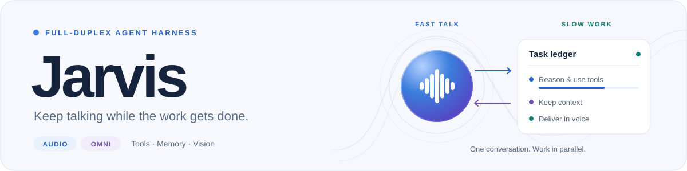
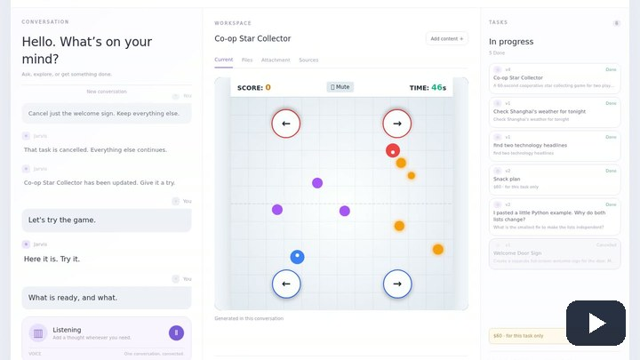
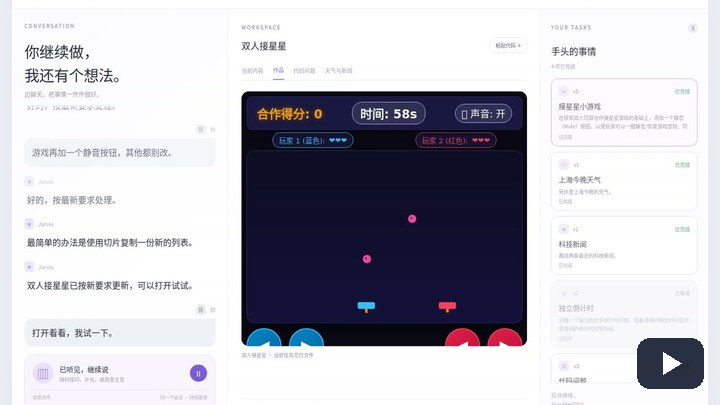
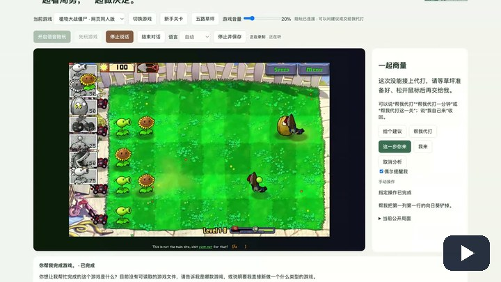
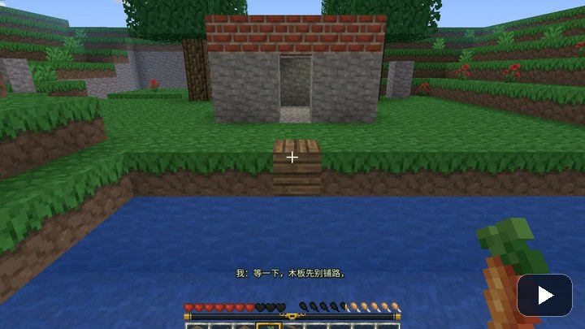
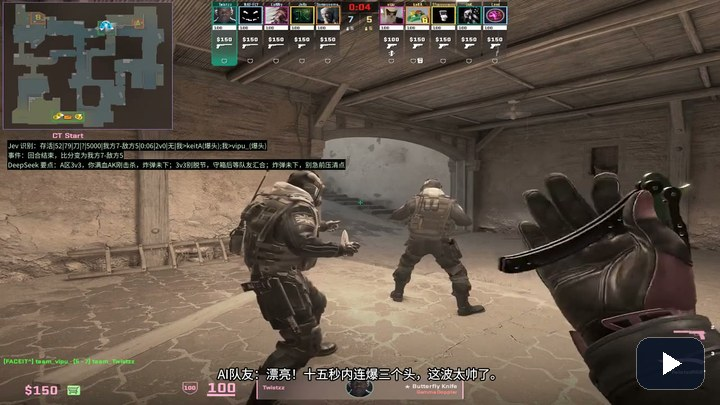
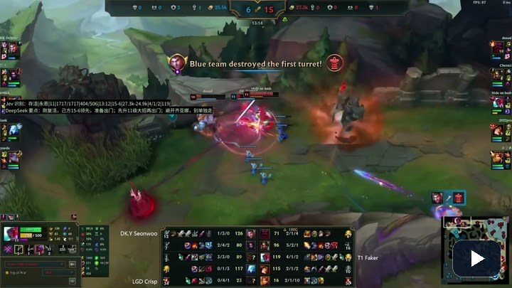
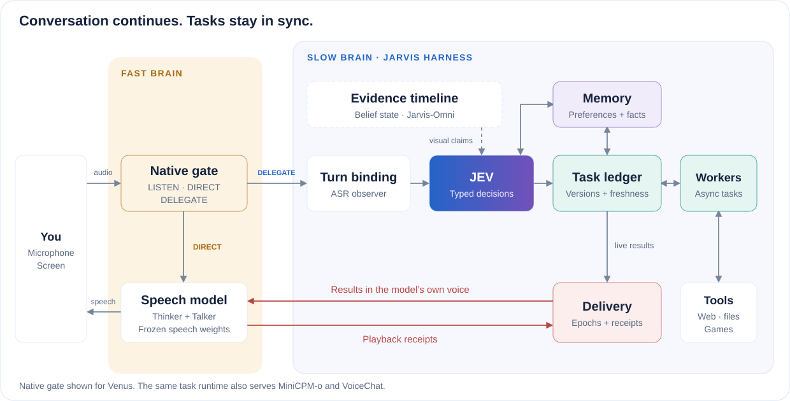

<p align="center">
  <picture>
    <source media="(prefers-color-scheme: dark) and (max-width: 600px)" srcset="docs/assets/hero-mobile-dark.svg">
    <source media="(max-width: 600px)" srcset="docs/assets/hero-mobile.svg">
    <source media="(prefers-color-scheme: dark)" srcset="docs/assets/hero-dark.svg">
    
  </picture>
</p>

<p align="center">
  <strong>Coordination Deserves a Brain of Its Own<br>in Agentic Interactive Models</strong>
</p>

<p align="center">
  <a href="https://arxiv.org/abs/2610.23804"></a>
  <a href="https://amphionteam.github.io/Jarvis-Demo/"></a>
  <a href="#quick-start"></a>
  <a href="LICENSE"></a>
</p>

<p align="center">
  <a href="https://arxiv.org/abs/2610.23804">Paper</a> &nbsp;·&nbsp;
  <a href="https://amphionteam.github.io/Jarvis-Demo/">Watch demos</a> &nbsp;·&nbsp;
  <a href="#quick-start">Quick start</a> &nbsp;·&nbsp;
  <a href="#how-it-works">Architecture</a> &nbsp;·&nbsp;
  <a href="docs/models.md">Model guide</a> &nbsp;·&nbsp;
  <a href="README_zh.md">简体中文</a>
</p>

Jarvis connects full-duplex conversation to background reasoning, tools and memory. Keep talking while tasks run, refine a request, interrupt a reply and return to its result later.

<table>
  <tr>
    <td width="440" valign="top">
      <p><strong><a href="#quick-start">Jarvis-Audio</a></strong></p>
      <p>Talk naturally while tools and tasks run.</p>
      <p><sub>Realtime-Venus-Audio · MiniCPM-o · NVIDIA VoiceChat</sub></p>
    </td>
    <td width="440" valign="top">
      <p><strong><a href="#jarvis-omni">Jarvis-Omni</a></strong></p>
      <p>Talk about your screen and game audio.</p>
      <p><sub>Venus-Omni · screen + game audio</sub></p>
    </td>
  </tr>
</table>

Both share the same task ledger, asynchronous workers, memory and playback control.

## Demos

Click a preview to watch the recorded session.

<table>
  <tr>
    <td width="33%" align="center" valign="top">
      <a href="https://amphionteam.github.io/Jarvis-Demo/#demo-audio-daily-en"></a>
      <br><strong>English</strong>
      <br><sub>Audio · daily tasks</sub>
    </td>
    <td width="33%" align="center" valign="top">
      <a href="https://amphionteam.github.io/Jarvis-Demo/#demo-audio-daily-zh"></a>
      <br><strong>Chinese</strong>
      <br><sub>Audio · daily tasks</sub>
    </td>
    <td width="33%" align="center" valign="top">
      <a href="https://amphionteam.github.io/Jarvis-Demo/#demo-audio-pvz"></a>
      <br><strong>PvZ</strong>
      <br><sub>Audio · shared play</sub>
    </td>
  </tr>
  <tr>
    <td width="33%" align="center" valign="top">
      <a href="https://amphionteam.github.io/Jarvis-Demo/#demo-audio-minecraft-1"></a>
      <br><strong>VoxeLibre</strong>
      <br><sub>Audio · explore &amp; build</sub>
    </td>
    <td width="33%" align="center" valign="top">
      <a href="https://amphionteam.github.io/Jarvis-Demo/#demo-omni-cs2"></a>
      <br><strong>CS2</strong>
      <br><sub>Omni · tactical advice</sub>
    </td>
    <td width="33%" align="center" valign="top">
      <a href="https://amphionteam.github.io/Jarvis-Demo/#demo-omni-lol"></a>
      <br><strong>League of Legends</strong>
      <br><sub>Omni · game context</sub>
    </td>
  </tr>
</table>

## Quick start

**Linux · Python 3.11 · NVIDIA GPU with BF16 support · a browser with microphone access**

This example runs Venus and ASR on separate GPUs. See the [model guide](docs/models.md) for GPU memory requirements and remote model services.

### 1. Install

```bash
git clone https://github.com/JensenYX/Jarvis.git
cd Jarvis
python3.11 -m venv .venv
source .venv/bin/activate
python -m pip install --upgrade pip
python -m pip install .
cp .env.example .env
```

Fill in `WORKER_API_KEY` and `TYPESAFE_API_KEY` in `.env`. The default worker is DeepSeek; `WORKER_BASE_URL` and `WORKER_MODEL` select another compatible Chat Completions endpoint. JEV can also run as a [local service](docs/models.md#local-jev).

### 2. Prepare the models

```bash
jarvis setup venus
jarvis setup asr
jarvis models download venus asr
```

Each model service gets its own Python environment. The small Audio and Omni adapters are included in this repository; base models are downloaded on demand.

### 3. Start talking

Open three terminals and activate the harness environment in each with `source .venv/bin/activate`.

**Terminal 1 · Speech model**

```bash
jarvis models serve venus --gpu 0
```

**Terminal 2 · Speech recognition**

```bash
jarvis models serve asr --gpu 1
```

**Terminal 3 · Application**, once both models have loaded:

```bash
jarvis doctor
jarvis serve
```

Open **http://localhost:8765**, choose a language, click **开始对话 / Start conversation**, and allow microphone access.

<details>
<summary><strong>Things to try</strong></summary>

- “Use a calculator to check 645 times 27.”
- “Create a small HTML game with a restart button.”
- “Change the game to a light theme.”
- “Stop talking.” Then: “Read that result again.”
- “Remember that I prefer concise answers.”

</details>

<details>
<summary><strong>Running on a remote server</strong></summary>

Forward the application port to your computer:

```bash
ssh -N -L 8765:127.0.0.1:8765 user@server
```

Open **http://localhost:8765** in your local browser. Microphone and screen capture also work when the application is served over HTTPS.

</details>

## How it works

<picture>
  <source media="(prefers-color-scheme: dark)" srcset="docs/assets/architecture-dark.svg">
  
</picture>

<p align="center"><sub><a href="docs/assets/architecture.svg">View architecture at full size</a></sub></p>

| Responsibility | What Jarvis coordinates |
| --- | --- |
| **Delegation** | The front model keeps the conversation moving. Venus uses a small adapter on its native control tokens while speech weights stay frozen. |
| **Task versions** | JEV chooses operations constructed from the current tasks. Refinements and cancellations name a specific task version. |
| **Current results** | Workers check context before executing tools. Task versions that have been replaced or cancelled stop delivering results. |
| **Playback** | Complete playback receipts confirm delivery. An interrupted result stays available to hear again. |
| **Memory** | Durable preferences and facts persist across sessions; temporary instructions stay with their task. |
| **Visual evidence** | Omni aligns media on one clock and checks visual claims before and during playback. |

Built-in tools cover calculation, web search and page reading, weather, news, document search, file creation and editing, and personal-memory retrieval. [Add your own tool →](docs/extending.md)

## Choose a frontend

| Frontend | Background-work admission | Start the application |
| --- | --- | --- |
| Realtime-Venus-Audio | Native control-token gate | `jarvis serve --frontend venus` |
| MiniCPM-o | Causal ASR admission, native text prefill for results | `jarvis serve --frontend minicpm` |
| NVIDIA VoiceChat | Native function-call and result channels | `jarvis serve --frontend voicechat` |
| Venus-Omni | Native audio-visual gate and visual evidence | `jarvis serve --mode omni` |

Install and start the matching model service before changing the frontend. [Model installation and configuration →](docs/models.md)

## Jarvis-Omni

Share a game window and talk about what is happening on screen. Jarvis-Omni combines Venus-Omni with a media timeline and visual evidence checks.

<details>
<summary><strong>Install and run Jarvis-Omni</strong></summary>

After installing the harness, install FFmpeg and prepare the local models:

```bash
jarvis setup venus
jarvis setup asr
jarvis setup omni
jarvis models download venus-omni asr jev-omni vision
```

Set `GEMINI_API_KEY`, `GEMINI_BASE_URL` and `GEMINI_MODEL` in `.env` for visual review. Activate the harness environment and run each service in a **separate terminal**:

| Terminal | Command |
| --- | --- |
| Speech model | `jarvis models serve venus-omni --gpu 0` |
| Speech recognition | `jarvis models serve asr --gpu 1` |
| Multimodal decisions | `jarvis models serve jev-omni --gpu 2` |
| Visual descriptions | `jarvis models serve vision --gpu 3` |

Once the services have loaded, start the application in another terminal:

```bash
jarvis doctor --mode omni
jarvis serve --mode omni --game cs2
```

Open **http://localhost:8765**, start the conversation, and select a window with **选择游戏窗口 / Share game window**. Choose CS2 or League of Legends before sharing. Enable game audio in the browser's sharing dialog when available. The commentary selector controls how often Jarvis speaks proactively.

</details>

[Visual readers and included adapters →](docs/models.md#visual-readers) &nbsp;·&nbsp; [Screen and game setup →](docs/games.md)

## Game integrations

| Game | Interaction | Setup |
| --- | --- | --- |
| PvZ web fan game | Advice, single moves, and handing over or reclaiming play | `jarvis setup pvz`, then `jarvis serve --game pvz` |
| Luanti / VoxeLibre | Explore a persistent world and cooperate on tasks | `jarvis setup voxel`, then `jarvis games start voxel` |
| CS2 | Screen-based conversation and tactical advice | `jarvis serve --mode omni --game cs2` |
| League of Legends | Screen-based conversation, visual facts and advice | `jarvis serve --mode omni --game lol` |

PvZ and VoxeLibre connect through game bridges with explicit action grants and engine receipts. CS2 and League of Legends use screen capture. [Installation, controls and ports →](docs/games.md)

## Configuration and extension

| Guide | What you can do |
| --- | --- |
| [Models and configuration](docs/models.md) | Choose a frontend, plan GPU resources and connect model services. |
| [Game integrations](docs/games.md) | Set up PvZ, Luanti / VoxeLibre and screen capture. |
| [Extend Jarvis](docs/extending.md) | Register tools, connect a frontend and use the typed decision interface. |
| [Examples](examples/) | Start from a custom tool or a model configuration. |

`jarvis serve --config path/to/config.yaml` loads overrides for the packaged defaults. Environment variables configure credentials and endpoints. Runtime data defaults to `~/.local/share/jarvis`; set `JARVIS_DATA_DIR` or `JARVIS_MODEL_DIR` to choose storage locations.

<details>
<summary><strong>Repository layout</strong></summary>

```text
jarvis/
  core/       Tasks, workers, tools, memory and playback
  audio/      Native admission and frontend transports
  omni/       Media timeline, visual claims and screen interaction
  adapters/   Model inference services and native gates
  games/      PvZ and VoxeLibre bridges
  resources/  Prompts, browser client, defaults and small adapters
examples/     Tool registration and configuration examples
```

</details>

## Citation

If Jarvis is useful in your research, please cite our paper:

> **[Jarvis: Coordination Deserves a Brain of Its Own in Agentic Interactive Models](https://arxiv.org/abs/2610.23804)**<br>
> Yuxiang Wang, Shengbo Cai, Zhixian Zhao, Yingda Shen, Yuancheng Wang, Xueyao Zhang, Liqiang Zhang, Teddy Sun, Steve Yves, Zhizheng Wu<br>
> *arXiv preprint arXiv:2610.23804*, 2026 &nbsp;·&nbsp; [Abstract](https://arxiv.org/abs/2610.23804) &nbsp;·&nbsp; [PDF](https://arxiv.org/pdf/2610.23804)

```bibtex
@misc{wang2026jarvis,
  title         = {Jarvis: Coordination Deserves a Brain of Its Own in Agentic Interactive Models},
  author        = {Wang, Yuxiang and Cai, Shengbo and Zhao, Zhixian and Shen, Yingda and Wang, Yuancheng and Zhang, Xueyao and Zhang, Liqiang and Sun, Teddy and Yves, Steve and Wu, Zhizheng},
  year          = {2026},
  eprint        = {2610.23804},
  archivePrefix = {arXiv},
  primaryClass  = {cs.SD},
  url           = {https://arxiv.org/abs/2610.23804}
}
```

## License

Original harness code and released adapters use [Apache-2.0](LICENSE). The VoxeLibre bridge and game patches retain their respective licenses. Downloaded models and games retain their upstream licenses; the PvZ fan game is for personal, noncommercial use. See [third-party components](licenses/THIRD_PARTY.md).
